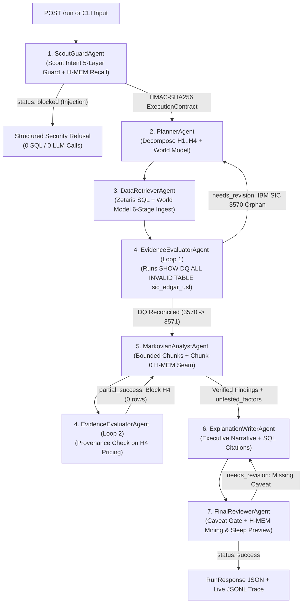

# AuditWhy — Autonomous Multi-Agent Financial, Taxonomic & Operational Discrepancy Investigator

**Track:** The Agent That Can Explain Why · **Sponsor tech:** Zetaris (data) · Meterless Engines + Nightshift (build/power) · NVIDIA Nemotron (models) · **Run:** `python run.py` → `POST /run`

**Live demo:** https://auditwhy.vercel.app (sample mode, no login; `POST https://auditwhy.vercel.app/run` accepts the same payloads as `input_examples/`)

[](https://github.com/Jae3y/AuditWhy/actions/workflows/ci.yml) [](https://vercel.com/new/clone?repository-url=https%3A%2F%2Fgithub.com%2FJae3y%2FAuditWhy&project-name=auditwhy)

## What we built

AuditWhy answers "why don't our numbers match?" for finance and risk analysts. You send a question such as *"Why did enterprise retention drop in Q3, and why doesn't our revenue reporting agree with SEC filings?"*. Seven agents then plan hypotheses, query every source through Zetaris and challenge each other's evidence. They return a cited explanation, with confidence intervals, a list of what could not be tested, and recommended actions. Any claim without supporting rows is struck out instead of asserted.

## Problem

The evidence for a metric discrepancy lives in disconnected systems: regulatory filings, an industry taxonomy, billing and support telemetry. A naive join between them loses data without any error. In our example, IBM files under SIC `3570`, a summary code that does not exist in the 4-digit leaf table. A standard join silently drops IBM and its $62.75B of revenue from every industry rollup. Analysts also reach for plausible stories ("pricing changes caused churn") that the data never tested. AuditWhy finds the first kind of problem and refuses the second.

## Agents

| Agent | Responsibility | Can block or send work back? |
| :--- | :--- | :--- |
| ScoutGuardAgent | Screens the question (5-layer guard), recalls H-MEM rules, signs an HMAC execution contract | Blocks injection, DDL and exfiltration attempts |
| PlannerAgent | Writes falsifiable hypotheses H1–H4 and a retrieval plan | Revises the plan when the Evaluator rejects it |
| DataRetrieverAgent | Verifies the contract, then queries every source through Zetaris SQL; grounds rows in the World Model | Expands the SIC hierarchy on a revision pass |
| EvidenceEvaluatorAgent | Runs its own Zetaris DQ query and checks every claim against the evidence ledger (provenance and statistical gates) | Sends the plan back; strikes unsupported claims |
| MarkovianAnalystAgent | Reasons in bounded Markovian chunks with compressed carryover; computes correlations with 95% CIs | Retries a chunk the Evaluator rejects |
| ExplanationWriterAgent | Writes the executive explanation with SQL citations | Rewrites on Reviewer request |
| FinalReviewerAgent | Enforces the correlation-vs-causation caveat and mines reusable rules into H-MEM | Sends the draft back to the Writer |

## What makes this an agent system

It is not a fixed pipeline. Two critique loops change what runs next:
- the Evaluator rejects the joined evidence and sends the plan back for a hierarchy-expanding second retrieval;
- the Reviewer rejects a draft without the caveat.

Verdicts are computed in code from the rows retrieved in that run. Change the data (for example Oracle's SIC code) and the agents catch the new orphan and recompute; the perturbation tests in `tests/test_investigation_integrity.py` check this. Memory compounds across runs: a warm run recalls the reconciliation rule and skips a whole stage. Every step is written to a JSONL trace in `logs/`.

## Data used

| Source | Table | Origin |
| :--- | :--- | :--- |
| SEC EDGAR company facts | `edgar.company_facts` | Real public XBRL filings (`data.sec.gov`), 10 companies including IBM (SIC 3570) |
| US SIC V4 taxonomy | `company_dns.sic_codes` | Public SIC leaf codes (`company-dns.mediumroast.io`) |
| ERP billing cohorts | `erp.customer_churn_billing` | **Synthetic**, made for this project; deliberately has no pricing-change table |
| Support and usage telemetry | `ops.support_tickets_usage` | **Synthetic**, made for this project |

In live mode all four are registered in Zetaris as REST tables plus schemastore views (`scripts/zetaris_onboard.py`), alongside the official `sic_edgar_usl` semantic layer. In sample mode (`SAMPLE_MODE=true`, the default) the same files in `data/sample/` are served through a read-only SQL mirror, so anyone can run the full agent loop **with no credentials**. See `data/README.md`.

---

## Hackathon Track Alignment (Open Agent Hackathon 2026)

| Role | Track | How AuditWhy Delivers |
| :--- | :--- | :--- |
| **Primary Track** | **Track 02 — The Agent That Can Explain Why** | Moves beyond surface-level KPI reporting to falsifiable root-cause explanation: formulates 4 explicit hypotheses (`H1`–`H4`) that start `pending` and are decided only by retrieved rows, shows *why* Q3 retention dropped (timeout rate vs. retention loss `r = 0.962`, 95% CI `0.843..0.991`, computed live from `ops.support_tickets_usage`), proves *why* BI dashboards missed `$62.753B` in SEC revenue (the **IBM SIC 3570** summary-vs-leaf anomaly), blocks unsupported pricing and competitor claims through a generic provenance gate, and enforces a *Correlation vs. Causation & Untested Factors* caveat that the reviewer audits line by line. |
| **Secondary Track** | **Track 01 — Solving Fragmented Intelligence** | Reconciles 4 disparate enterprise silos—SEC EDGAR XBRL filings (`edgar.company_facts`), US SIC V4 taxonomy (`company_dns.sic_codes`), ERP contract cohorts (`erp.customer_churn_billing`), and API/support telemetry (`ops.support_tickets_usage`)—into a single Zetaris Unified Semantic Layer (`sic_edgar_usl`) and an idempotent Meterless `World Model` (`ent_<sha256>`). |
| **Secondary Track** | **Track 03 — Reasoning Architecture** | Implements a non-linear 7-agent critique-and-revision state machine backed by `Markovian` bounded-context chunk reasoning (`[STATE_CHECKPOINT]` $\rightarrow$ `[TASK_COMPLETE]`), `H-MEM` 8-factor hybrid recall at chunk 0, and `Scout Intent` 5-layer security + HMAC-SHA256 signed `ExecutionContract` enforcement. |

---

## System Architecture (7-Agent Non-Linear Loop + 3-Layer Sponsor Stack)

```text
+=========================================================================================+
|                         USER / JUDGE REQUEST (POST /run or CLI)                         |
+=========================================================================================+
                                            |
                                            v
+-----------------------------------------------------------------------------------------+
| [AGENT 1] ScoutGuardAgent                                                               |
|  * Meterless Scout Intent: Sense -> Interpret -> 5-Layer Guard -> Route -> Recommend    |
|  * Blocks Prompt Injection / DDL (`DROP TABLE`) / Secret Exfiltration (`example_3.json`)|
|  * Queries Meterless H-MEM (8-factor hybrid score) & issues HMAC-SHA256 Contract (300s) |
+-----------------------------------------------------------------------------------------+
                                            |
                                            v
+-----------------------------------------------------------------------------------------+
| [AGENT 2] PlannerAgent  <-----------------------------------------------+               |
|  * Decomposes query into 4 falsifiable hypotheses (H1..H4)              |               |
|  * Registers initial investigation scope in Meterless World Model       |               |
+-------------------------------------------------------------------------+               |
                                            |                             |               |
                                            v                             |               |
+-------------------------------------------------------------------------+               |
| [AGENT 3] DataRetrieverAgent (Pass 1 & Pass 2 Hierarchy Recovery)       | Critique &    |
|  * Verifies Scout HMAC-SHA256 ExecutionContract before every SQL call   | Revision      |
|  * Queries Zetaris Lightning SQL (`http://localhost:8888/api/v1.0`)     | Loop 1:       |
|  * Ingests rows into idempotent 6-stage World Model (`ent_<16-hex>`)    | Catches IBM   |
+-------------------------------------------------------------------------+ SIC 3570      |
                                            |                               Orphan        |
                                            v                               ($62.753B)    |
+-------------------------------------------------------------------------+               |
| [AGENT 4] EvidenceEvaluatorAgent                                        |               |
|  * Loop 1: Runs `SHOW DQ ALL INVALID TABLE sic_edgar_usl` (`fk_sic_check`) -------------+
|    Detects IBM (CIK 0000051143) reports 3-digit summary SIC `3570`, absent from 4-digit |
|    leaf table (`3571..3577`). Triggers Pass 2 hierarchy recovery (`LIKE '357%'`).       |
|  * Loop 2: Audits Analyst draft against Zetaris row provenance; BLOCKS H4 (pricing      |
|    changes) because `erp.pricing_tier_changes` returned 0 rows -> `untested_factors`.   |
+-----------------------------------------------------------------------------------------+
                                            |                             ^
                                            v                             | Critique &
+-------------------------------------------------------------------------+ Revision
| [AGENT 5] MarkovianAnalystAgent                                         | Loop 2:
|  * Meterless Markovian Engine: H-MEM injected into Chunk 0 ONLY         | Strips H4
|  * 4-step carryover compression (`[STATE_CHECKPOINT]`->`[TASK_COMPLETE]`)| Pricing Claim
|  * Cold Run: 4 stages | Warm Run (H-MEM recall): 3 stages (no taxonomy  +---------------+
|    discovery); ~38% measured token saving vs a full-history chain        |
+-----------------------------------------------------------------------------------------+
                                            |
                                            v
+-----------------------------------------------------------------------------------------+
| [AGENT 6] ExplanationWriterAgent  <-----(Needs Revision: Add Caveat)----+               |
|  * Synthesizes executive root-cause report with Zetaris SQL citations   |               |
+-------------------------------------------------------------------------+               |
                                            |                                             |
                                            v                                             |
+-----------------------------------------------------------------------------------------+
| [AGENT 7] FinalReviewerAgent                                                            |
|  * Enforces mandatory "Correlation vs. Causation & Untested Factors" caveat ------------+
|  * Mines resolved IBM SIC `3570 -> 3571` rule into H-MEM + Trust Ledger + Sleep Preview |
+=========================================================================================+
```



---

## Quickstart Commands

### 0. The Three-Minute Demo (one command)
```bash
python scripts/demo.py --pause
```
Plays the whole story against a throwaway memory store, so it is identical on every machine:
1. **Cold catch:** the evaluator's own DQ check finds IBM's summary SIC 3570 and Pass 2 reconciles it ($62.753B restored), while pricing and competitor claims are blocked.
2. **Compounding:** a *differently worded* question reuses the mined rule (2 → 1 retrieval passes, 4 → 3 stages, trust ledger `helpful`).
3. **Adversarial block:** prompt injection is refused before any SQL or model call.
4. **Proof it isn't scripted:** Oracle's SIC is changed to 7370 live; the new orphan is caught and restored revenue is recomputed. Asking about Oracle refutes the retention-drop hypothesis.

`--pause` waits for Enter between acts.

### 1. Local Virtual Environment (`SAMPLE_MODE=true` — Zero Credentials Required)
Requires **Python 3.11+** (CI runs 3.11 and 3.12). Judges can run the entire 7-agent state machine, all 4 Meterless Engines, SQL execution over `data/sample/`, and test verification immediately with zero external API keys:

```bash
# 1. Create and activate virtual environment
python -m venv .venv
# Windows PowerShell:
.\.venv\Scripts\Activate.ps1
# Linux / macOS:
# source .venv/bin/activate

# 2. Install dependencies (requirements.txt = runtime only; -dev adds pytest)
pip install -r requirements-dev.txt

# 3. Sample mode needs no configuration (defaults: SAMPLE_MODE=true, PORT=8000).
#    For live mode, create a .env file (git-ignored) with:
#      SAMPLE_MODE=false
#      ZETARIS_API_KEY=...          # Zetaris UI > Management > API Tokens
#      METERLESS_RUNTIME_TOKEN=...  # Nightshift > Console > Runtime access token
#    Optional: ZETARIS_REST_URL (default http://localhost:8888/api/v1.0), ZETARIS_ORG_ID (default 1),
#    METERLESS_BASE_URL (default http://127.0.0.1:8088/v1), SOURCE_TIMEOUT_SECONDS (default 30).

# 4. Run the full unit, engine conformance, provider v4, and end-to-end test suite
python -m pytest tests/ -v

# 5. Run the Conformance & Smoke Verification scripts
python scripts/run_conformance.py
python scripts/smoke_test.py
```

### 2. CLI Execution Across All 3 Canonical Input Examples
Each run writes its full report to `runs/` (git-ignored). The committed evidence in `output_examples/` is the 27 Oct fully live run: `live_example_1.json` (cold) and `live_example_2.json` (memory follow-up).
```bash
# Example 1: Cold Investigation Run (Catches IBM SIC 3570 orphan, blocks H4 pricing claim, mines rule into H-MEM)
python run.py --input input_examples/example_1.json --output runs/example_1.json

# Example 2: Warm Memory Compounding Run (Recalls SIC 3570->3571 rule at Chunk 0: 1 retrieval pass, 3 stages vs 4, no retry)
python run.py --input input_examples/example_2.json --output runs/example_2.json

# Example 3: Adversarial Prompt Injection & Conflict Test (Scout 5-layer guard blocks DROP TABLE & exfiltration)
python run.py --input input_examples/example_3.json --output runs/example_3.json
```

### 3. Start the FastAPI Server + Interactive Lineage Dashboard (`0.0.0.0:8000`)
```bash
python run.py
```
- **Interactive UI Dashboard:** Open `http://localhost:8000/` in your browser.
- **Health Check (`GET /health`):**
  ```bash
  curl http://localhost:8000/health
  ```
- **Judge Payload (`POST /run`):**
  ```bash
  curl -X POST http://localhost:8000/run \
    -H "Content-Type: application/json" \
    -d @input_examples/example_1.json
  ```

### 4. Docker Build & Run
```bash
docker build -t auditwhy:latest .
docker run --rm -p 8000:8000 -e PORT=8000 -e SAMPLE_MODE=true -e AUDITWHY_ADMIN_TOKEN=change-me auditwhy:latest
```
Inside Docker the browser is not a loopback client, so the credentials panel needs the admin token (there is a field for it in the dashboard). For live mode use `docker run --rm -p 8000:8000 --env-file .env auditwhy:latest`, and replace `localhost` / `127.0.0.1` in `.env` with `host.docker.internal`, because inside a container `localhost` is the container itself.

### 5. Live Mode: Zetaris + Meterless Nightshift + NVIDIA Nemotron
Per the Participant Setup Guide, Zetaris and Nightshift run **on your machine**. The app never holds your NVIDIA key.

1. **Zetaris:** register at `cloud.enterprise.zetaris.com`, download the platform bundle, run its `docker login` command, then `docker compose up -d` and `./verify.sh`. For credentials, either create an API token in the UI at `http://localhost:3000` under **Management > API Tokens > +** (`ZETARIS_API_KEY`), or set `ZETARIS_USERNAME` / `ZETARIS_PASSWORD` to the bundle's admin account. AuditWhy then signs in through `/api/auth/login`, as zetaris/getting-started's own scripts do.
   - *Antivirus HTTPS scanning* (for example Avast Web Shield) re-signs certificates with its own root, which the engine's Java rejects (`PKIX path building failed`). Mount a copy of the JDK trust store that includes that public root through a `docker-compose.override.yml` in the bundle folder, rather than turning the scanner off.
   - After building `sic_edgar_usl`, run `CACHE TABLE` on its `sec_data.*_submissions_raw` sources. Otherwise every DQ query refetches `data.sec.gov`.
2. **Official USL + DQ rule:** in a clone of [zetaris/getting-started](https://github.com/zetaris/getting-started), run `python3 scripts/onboard.py run sic_edgar_usl --dry-run`, then run it again without `--dry-run`. This builds `lightning.metastore.usl_demo.sic_edgar_usl`, whose foreign-key DQ rule flags IBM's SIC 3570 against live SEC EDGAR data.
3. **AuditWhy's internal tables:** `python scripts/zetaris_onboard.py` prints the statements (dry run). `python scripts/zetaris_onboard.py --apply` registers ERP billing, support telemetry, EDGAR facts and SIC leaves as Zetaris REST tables plus `auditwhy.*` views, from this repo's `data/zetaris/*.json`, then verifies row counts.
4. **Nightshift:** install the desktop build (Windows: meterless.ai/windows.html; no NVIDIA GPU needed, since cloud lanes use NVIDIA's hosted API) and leave it running. Paste your `nvapi-` key into **Setup > Providers > Cloud provider keys > NVIDIA**, then restart Nightshift once so the engine loads the key. The runtime serves `http://127.0.0.1:8088/v1` and writes its token to `%LOCALAPPDATA%\ai.meterless.runtime\proxy-token` on Windows.
5. **`.env`:** set `ZETARIS_API_KEY`, `SAMPLE_MODE=false`, and either `METERLESS_RUNTIME_TOKEN` or `METERLESS_TOKEN_FILE` (pointing at the `proxy-token` file, so the token is never copied). Optionally pin a lane with `METERLESS_MODEL`. Input files can also force a mode: `options.sample_mode` in a payload overrides the env value.
6. **Verify:** `python scripts/live_check.py` runs the setup guide's checks (Zetaris `SELECT 1`, every mapped table, the official DQ target, Nightshift `/v1/models`, a real completion, and which model served it). Then run `python run.py --input input_examples/example_1.json --output output_examples/live_example_1.json`.

The agents query canonical names (`edgar.company_facts`, `erp.customer_churn_billing`, ...). `data/zetaris_table_map.json` maps them to what exists on your instance; override it with `ZETARIS_TABLE_MAP` if you used different names. `provider_routing.calls[].served_by` records the concrete Nemotron model behind each Nightshift routing mode, which is the evidence the NVIDIA Nemotron award asks for.

### 6. Public Demo (Vercel)
Hosted at **https://auditwhy.vercel.app**, and every push to `main` redeploys it. The **Deploy with Vercel** button above (or importing the repo at vercel.com/new) deploys your own copy: Vercel's FastAPI preset serves `api/index.py` with no further configuration. A hosted instance has no route to your local Zetaris or Nightshift, so it always runs sample mode: the full agent loop on `data/sample/`, with credential editing disabled. Traces and H-MEM live in `/tmp`, so compounding persists only while an instance stays warm. For the live stack, run locally (section 5).

---

## How a Verdict Is Reached (Nothing Is Pre-Written)

Every number, status and sentence in a `RunResponse` is derived from rows the agents retrieved in that run. Change a value in `data/sample/` and the report changes with it (`tests/test_investigation_integrity.py` does exactly that).

1. **Plan.** `PlannerAgent` emits hypotheses with `status: "pending"` plus a retrieval plan. Each hypothesis declares the datasets that must return rows before any claim about it may be asserted (H4 needs `erp.pricing_tier_changes`; the competitor confounder needs `crm.opportunity_loss_reasons`).
2. **Retrieve.** `DataRetrieverAgent` executes the plan and records every statement in the `evidence_ledger` (purpose, hypotheses, tables, status, row count). A relation missing from the catalog returns `TABLE_NOT_FOUND`, exactly like a Zetaris catalog miss.
3. **Critique the data.** `EvidenceEvaluatorAgent` runs its *own* `SHOW DQ ALL INVALID TABLE ... sic_edgar_usl` and compares the orphans against the filings that actually carry a leaf code in the joined evidence. Any orphan missing from the join means the join silently dropped data, so it emits `needs_revision`. Nothing in that check names IBM or 3570.
4. **Recover.** Pass 2 expands each orphaned summary code through `company_dns.sic_codes` (`parent_summary_code`) and rebuilds the join from the discovered mapping (`app/reconciliation.py`). The evaluator then re-runs its DQ check to verify the fix. The loop is bounded by `options.max_retries`.
5. **Analyse in bounded chunks.** `MarkovianAnalystAgent` runs cohort scan → taxonomy reconciliation → operational correlation → candidate synthesis as Markovian chunks over World Model entities. It deliberately drafts a claim for *every* hypothesis, pricing included.
6. **Critique the claims.** The evaluator blocks any claim whose required datasets returned no rows. Correlation claims also need `|r| ≥ 0.7` with `n ≥ 5`, otherwise they are downgraded to `inconclusive`. Blocked claims become `untested_factors`, together with the data needed to test them.
7. **Review.** `FinalReviewerAgent` checks three gates: the caveat names every untested factor and every correlational statistic; the summary contains no causal language about a blocked factor; and every finding cites evidence tables.

**Leaf policy:** a summary code usually has several leaves beneath it (3570 has 3571–3579). By default the filer is mapped to the primary leaf (`primary_leaf`, the SIC "...1" convention, so 3571 Electronic Computers), which never depends on who else is in the dataset. `AUDITWHY_SIC_LEAF_POLICY=peer_majority` maps it to the leaf most used by its industry-group peers instead. Either way the filer stays in its industry group, so group-level revenue and ARR totals are identical. Each finding records the policy used and every candidate, so the attribution is auditable.

Confidence is computed, not asserted: H3 uses the lower bound of the 95% Fisher-z confidence interval on Pearson r, and the run's overall confidence is the mean of tested hypotheses, discounted 5% per untested one. The same pipeline handles questions the demo never anticipated. Ask about Oracle and the focus becomes Oracle, and H1 is **refuted** (102% net retention).

### H-MEM Memory Policy (`options.warm_memory_seed`)

| Value | Policy | Use |
| :--- | :--- | :--- |
| *unset* | `auto`: apply any recalled high-trust (`≥ 0.85`, not superseded, not `needs_review`) structured rule | Normal operation; this is how compounding happens organically |
| `false` | `cold`: recall for telemetry, never apply | Reproducible discovery baseline (`example_1`) |
| `true` | `warm`: seed a clearly-labelled prior-session fixture if the store is empty, then apply | Standalone warm demo on a fresh clone (`example_2`) |

Rules are scored by outcome. A recalled rule that restores its filer gets `helpful` (+0.05). A rule that fails is detected by the evaluator, replaced by fresh discovery, and penalised with `wrong` (−0.20, `needs_review`); the corrected rule is stored under a new id and supersedes it through `ConflictDetectionService`. Re-mining a known rule *reinforces* it instead of resetting its earned confidence.

---

## Detailed 4-Part Sponsor Technology Architecture

### 1. Data Layer: Zetaris Networked Data Platform (`app/adapters/zetaris.py` & `scripts/zetaris_usl_setup.sql`)
- **Live Zetaris REST SQL Client:** Connects to `ZETARIS_REST_URL=http://localhost:8888/api/v1.0` (enforcing port `8888`, never `8889`) with `X-Org-ID: 1`, `X-Request-ID`, single-statement sanitization, trailing-semicolon stripping (preserving `COMPILE USL` blocks), and `tenacity` exponential backoff (`3` attempts, `20s` timeout).
- **Unified Semantic Layer (USL) & Data Quality (`fk_sic_check`):** `scripts/zetaris_usl_setup.sql` registers the SEC EDGAR XBRL REST source and Company-DNS US SIC V4 REST source, compiles `lightning.metastore.usl_demo.sic_edgar_usl`, and registers the foreign-key Data Quality rule `fk_sic_check`.
- **What Was Unique — Catching the Real-World IBM SIC `3570` Anomaly:** In SEC EDGAR (`edgar_company_facts.json`), **IBM (`CIK 0000051143`, `$62.753B` FY2025 revenue)** self-reports SIC code **`3570`** (*Computer and Office Equipment*). However, in the official US SIC V4 specification (`company_dns_sic_codes.json`), `3570` is a **3-digit Industry Group summary header**, *not* a 4-digit leaf code (`3571` Electronic Computers, `3572` Computer Storage Devices, `3575` Computer Terminals, `3577` Computer Peripheral Equipment, NEC). Naive inner joins silently drop `$62.753B` of IBM revenue! `EvidenceEvaluatorAgent` autonomously runs `SHOW DQ ALL INVALID TABLE lightning.metastore.usl_demo.sic_edgar_usl`, catches the `0000051143` orphan, and triggers a Pass-2 hierarchy recovery (`WHERE sic_code LIKE '357%'`) to reconcile IBM under `3571`.

### 2. Build Layer: All 4 Meterless Engines (`app/engines/`)
1. **H-MEM Hierarchical Memory (`app/engines/hmem.py`):**
   - Implements all 7 services (`MemoryStoreService`, `MemoryMiningService`, `MemoryRetrievalService`, `DreamingService`, `SleepCycleService`, `TrustLedgerService`, `ConflictDetectionService`).
   - Enforces mandatory `source` and `confidence` validation, entity cap (`10`), relatedTo cap (`5`), and the exact 8-factor hybrid scoring formula:
     $$\text{raw} = 0.35\cdot\text{semantic} + 0.20\cdot\text{keyword} + 0.10\cdot\text{tag} + 0.10\cdot\text{domain} + 0.15\cdot\text{entity} + 0.05\cdot\text{layer} + 0.05\cdot\text{recency} - 0.20\cdot\text{superseded}$$
     $$\text{score} = \text{clamp}_{0,1}(\text{raw}) \times \text{confidence}$$
   - Enforces low-trust overwrite protection (sources with `confidence < 0.50` cannot overwrite high-trust facts `>= 0.85`), feedback deltas (`helpful +0.05`, `not_helpful -0.03`, `wrong -0.20 + review`), and non-mutating `SleepCycleService.preview()`.
2. **Markovian Bounded-Context Reasoning (`app/engines/markovian.py`):**
   - Validates `ChunkConfig` bounds (`chunkSize 1000..128000`, `maxChunks 1..32`, `carryoverTokens 128..32768`, `overlapTokens 0..4096`) raising `MarkovianConfigError`.
   - Injects H-MEM into **Chunk 0 only** (`memoryContext + "\n\nTask: " + prompt`); continuation chunks receive only the ~200-char goal summary + compressed carryover.
   - Each chunk is a real analysis stage. The chunk plan comes from pending work, so a warm run skips taxonomy discovery and finishes in **3 stages instead of 4**.
   - Keeps two ledgers. `efficiencyPercent` is **measured**: the bounded prompts actually sent vs. what a naive chain re-sending the full transcript would send (about 38% on the 4-stage cold run, growing with chain length). `specProjectedEfficiencyPercent` applies the AGENTS.md formula, which assumes every prior chunk filled `chunkSize = 8000` (about 96%). It is kept for conformance only, because real chunks here are a few hundred tokens.
3. **World Model Shared Grounded State (`app/engines/world_model.py`):**
   - Implements `WorldStoreService`, 6-stage idempotent `IngestPipelineService` (`extract -> normalize -> resolve -> validate -> append -> project`), and `ContextBuilderService`.
   - Generates deterministic IDs (`ent_` + first 16 hex chars of `sha256(f"{entity_type.lower()}:{normalized_name.lower()}")`) and guarantees `diff_count == 0` on duplicate ingestion.
4. **Scout Intent Guard & Execution Contracts (`app/engines/scout_intent.py`):**
   - Executes `Sense -> Interpret -> Guard -> Route -> Recommend -> ExecutionContract`.
   - 5-Layer Guard blocks prompt injections, destructive SQL (`DROP TABLE`), secret exfiltration URLs, RBAC/scope violations, and PII leaks. Card numbers are redacted only when they pass a Luhn check, so CIKs and SIC codes survive. The rate limit is a process-wide sliding window, so it holds across runs.
   - Issues **HMAC-SHA256 signed `ExecutionContract`s** (`signedBy: "scout"`, 300s TTL) verified before every Zetaris tool call. Without `SCOUT_HMAC_KEY` the key is random per process, so contracts cannot be forged from a public default.

### 3. Power Layer: Meterless Nightshift Runtime 1.4 & NVIDIA Nemotron (`app/adapters/meterless_provider.py` & `app/llm.py`)
- **Nightshift is the primary provider** (Power rule): every agent model call goes to the OpenAI-compatible runtime with `Authorization: Bearer $METERLESS_RUNTIME_TOKEN`, `meterless-app: auditwhy` and `meterless-scope: user`, using a 180 s timeout. Nemotron is reached *through* Nightshift: the NVIDIA key lives only in Nightshift > Providers.
- Implements **Provider Contract v4**: URL normalisation to `<scheme>://<host>/v1` (never `/v1/v1`), Quick Connect links (`/connect#k=...`), immediate rejection of the placeholder `rt-local`, and a token read from env or `<stateDir>/proxy-token`. `GET /v1/models` decides status (401/403 → unauthorized; 200 with `meterless/*` ids → online; anything else → offline). Auto Detect covers ports 8088/8090/8787/11434 on `127.0.0.1`, `localhost` and `[::1]`.
- **Task routing (`plan_route`) gives each agent lane its own Nemotron model:**
  - `plan` / `retrieve` → `nvidia/nemotron-3.5-lightning-30b-a3b` (fast lane)
  - `evaluate` / `grade` → `nvidia/nemotron-3-ultra-550b-a55b` (judge lane, thinking enabled)
  - `analyze` / `synthesize` → `nvidia/nemotron-3.5-super-vl-120b-a12b`

  When Nightshift advertises a lane's model in `/v1/models`, AuditWhy requests it by id. On Nightshift 1.2.7 (Windows), the `meterless/deep` and `judge` modes all routed to the smallest lane, so requesting the model by id is what keeps the judge on Ultra. Otherwise the call uses the routing mode (`meterless/text.fast`, `meterless/judge.deep`, `meterless/text.auto`), falling back to `meterless/auto`. `METERLESS_MODEL` pins one lane for every task. Each call records `served_by`, the model Nightshift reports in `meterless.routed_model`. Reasoning that a lane leaks before `</think>` is stripped, and `max_tokens` has an 800 floor so reasoning lanes never return empty.
- **Verified fully live (27 Oct 2026, Zetaris 2.4.3 local bundle + Nightshift 1.2.7 on Windows):**
  - `example_1` ran 11/11 Zetaris queries live, with no fallback.
  - The official `sic_edgar_usl` DQ rule flagged IBM (SIC 3570) from live SEC EDGAR data and drove the revision loop.
  - 10/10 model calls were served by Nemotron (Lightning 30B, Ultra 550B, Bolt) through Nightshift.
  - The verdicts were identical to sample mode.

  The evidence is in `output_examples/live_example_*.json` and `docs/live_check_2026-10-27.txt`.
- **Optional direct Nemotron fallback** ("Option B" in the setup guide): if Nightshift is down and `NVIDIA_API_KEY` / `MODEL_API_KEY` is set, calls go to `integrate.api.nvidia.com` with the same lanes (`enable_thinking` sent as top-level `chat_template_kwargs`, with 2/4/8 s backoff on 429).
- **Division of labour:** verdicts (DQ, claim gates, reviewer gates) are always computed in code, so `SAMPLE_MODE=true` and a live run reach identical conclusions. Nemotron contributes the narrative for each Markovian chunk, the evaluator summaries, and the writer's executive narrative. Offline, each agent supplies its own data-derived text instead. Provider failures are recorded per call in `provider_routing.calls[].fallback_reasons`, never swallowed.

### 4. Development workflow
- Built with Claude Code as the AI coding assistant. Cursor is optional per the 22 Oct onboarding-guide update.
- A test-driven conformance harness (`scripts/run_conformance.py` and `tests/`) verifies compliance with all four `AGENTS.md` engine specs and the Provider v4 contract.

---

## Failure Handling & Resilience Matrix

| Failure Scenario | Detection Mechanism | Autonomous Recovery / Mitigation | Trace Status Logged |
| :--- | :--- | :--- | :--- |
| **Zetaris Cluster Unreachable / Timeout** | Transport errors, 5xx and 429 get 3 `tenacity` exponential retries (a 4xx is final and is not retried) | Logs `fallback_to_sample_data` and opens a per-run circuit breaker, so the remaining queries go straight to `SampleZetarisEngine` instead of each paying the retry backoff | `fallback` |
| **Live Zetaris Catalog Miss** | 4xx whose body says the table or view does not exist | Returned as `TABLE_NOT_FOUND` (same contract as the mirror) rather than silently answered from sample data | `success` (claim later blocked) |
| **Columnar or Nested Zetaris Payload** | `normalize_zetaris_rows()` | Accepts row-dicts, `columns` + row arrays, and `result`-nested shapes, so evidence is never silently empty | `success` |
| **Cross-Source Foreign Key Orphan (any summary SIC)** | `EvidenceEvaluatorAgent` runs `SHOW DQ ALL INVALID TABLE sic_edgar_usl` and diffs it against leaf-bearing joined rows | Emits `needs_revision`; Pass 2 expands each orphan through `parent_summary_code`; evaluator re-verifies (bounded by `max_retries`) | `needs_revision` $\rightarrow$ `retrying` $\rightarrow$ `success` |
| **Unverified Analyst Claim (`H4` pricing, competitor displacement)** | Provenance gate: a required dataset returned `0` rows or `TABLE_NOT_FOUND` | Blocks the claim (`flag_unsupported_claim`) and moves it to `untested_factors` with the data needed to test it | `partial_success` $\rightarrow$ `success` |
| **Weak or Under-Powered Correlation** | Statistical gate: `|r| < 0.7` or `n < 5` | Downgrades the hypothesis to `inconclusive` instead of asserting it | `success` |
| **Recalled H-MEM Rule Is Wrong** | Evaluator still finds the filer dropped after the rule was applied in Pass 1 | Fresh discovery replaces the rule; the old record gets `wrong` feedback and is superseded by the corrected one | `needs_revision` $\rightarrow$ `success` |
| **Missing / Incomplete Caveat or Causal Language about a Blocked Factor** | `FinalReviewerAgent` gates on caveat coverage, forbidden terms and finding provenance | Returns concrete issues to `ExplanationWriterAgent`, which revises against them | `needs_revision` $\rightarrow$ `success` |
| **Prompt Injection / `DROP TABLE` / Exfiltration** | `ScoutGuardAgent` 5-Layer Guard (`layer1_prompt_injection`) | Immediately halts execution before any SQL or LLM call and refuses tool contract | `blocked` |
| **Write SQL in the Workbench (`ATTACH`, `UPDATE`, ...)** | Read-only statement gate plus SQLite authorizer on the warehouse connection | Refused before and at the engine level, so no file or row can be written | `REJECTED_READ_ONLY` |
| **Unhandled Exception Mid-Run** | Orchestrator boundary | Returns a structured `status: "error"` response with the partial trace and evidence ledger | `fallback` |
| **Meterless Runtime `rt-local` or Offline** | `MeterlessProviderClient.probe_status()` on `GET /v1/models` (once per run) | Rejects `rt-local` as `"unauthorized"`; falls back to NVIDIA NIM (`2s/4s/8s` 429 backoff) or deterministic text, logging the reason | `success` |

## Security Model

- **Read-only data plane:** the sample warehouse connection runs under a SQLite authorizer that only permits reads. `/api/sql` additionally accepts only `SELECT/WITH/SHOW/EXPLAIN/DESCRIBE`, and `limit` is validated and clamped.
- **Admin endpoints:** `POST /api/credentials` accepts loopback callers, or `Authorization: Bearer $AUDITWHY_ADMIN_TOKEN` from anywhere else. Moving a provider URL to a new host without a new key clears the old key, so a key can never be redirected to an attacker's host. Values containing newlines are rejected before `.env` persistence.
- **Identifiers:** `run_id` / `request_id` are reduced to `[A-Za-z0-9_.-]` before they reach any filename.
- **Transport:** API-key-bearing calls never fall back to unverified TLS. `AUDITWHY_ALLOW_INSECURE_TLS` only affects the public, credential-free SEC/SIC probe.
- **Dashboard:** every server-supplied string is HTML-escaped before rendering, because trace summaries echo user queries and model output.

---

## Conformance & Test Suite Summary

GitHub Actions (`.github/workflows/ci.yml`) runs the test suite, conformance, smoke test and the demo on Python 3.11 and 3.12, then builds the Docker image and probes `/health` and `/run` inside the container.

`python scripts/run_conformance.py` verifies 7 subsystems: the four engines, the provider contract, the Zetaris DQ rule, and the orchestrated cold → compounding path. Running `python -m pytest tests/ -v` (83 tests) verifies the following. Tests run against an isolated logs/H-MEM directory (`tests/conftest.py`), so results never depend on a previous run.
- `tests/test_engines_conformance.py`: H-MEM mandatory source gate, 8-factor math, trust protection, non-mutating sleep preview; Markovian bounds, marker stripping, token math, memory seam; World Model `ent_` SHA-256 determinism & zero-diff idempotency; Scout Intent injection blocking & HMAC-SHA256 verification.
- `tests/test_provider_contract.py`: URL normalisation never `/v1/v1`, `rt-local` rejection, 8 `parse_connect_link` edge cases, and Nemotron task routing.
- `tests/test_end_to_end.py`: `GET /health`, the three canonical examples, Vibe Coding payload, workbench, telemetry and USL setup.
- `tests/test_investigation_integrity.py`: perturbs the warehouse and the question to prove verdicts are data-driven. Covers multiple and unseen summary codes (`7370`), a clean taxonomy with no revision, numbers that track the rows, focus-dependent refutation, organic compounding, the cold policy, the wrong-rule trust loop, and the evaluator's provenance and statistical gates.
- `tests/test_platform.py`: both leaf policies and their audit trail; six Zetaris payload shapes; live catalog-miss reporting without retries; the circuit breaker; telemetry tailing of large logs; and `LOG_LEVEL` behaviour.
- `tests/test_security.py`: engine-level write refusal, read-only workbench, `run_id` traversal, admin gating and key-redirect protection, `.env` injection, Luhn PII redaction, the shared rate limit, the non-public signing key, dashboard escaping, and the Nemotron `chat_template_kwargs` payload.

---

## API Contract (`POST /run`)
Accepts the judge payload `{run_id, input: {query}, options: {sample_mode, warm_memory_seed, max_retries}}` or the Vibe Coding payload `{request_id, user_query, context}`. Besides the detailed fields, every response carries the Technical Execution Requirements shape `{run_id, status, output: {summary, recommendations, artifacts}, agents: [{name, role}], trace_id, log_file, execution_time_seconds}`. It also carries the Vibe Coding shape `{agents_used, result: {summary, findings, confidence}, collaboration: {feedback_loop_completed, revision_count, evaluator_findings}, log_path}`. Failures return `status: "error"` with `error: {type, message, recoverable}` and the partial trace. Malformed input gets a 400/422, and a query over 4,000 characters gets a 413.

## AI and Model Usage
| Role | Model / service | Where |
| :--- | :--- | :--- |
| Narrative for Markovian chunks, evaluator summaries, executive narrative | Meterless Nightshift routing modes (`meterless/text.fast`, `meterless/judge.deep`, `meterless/text.auto`) backed by NVIDIA Nemotron lanes; optional direct `integrate.api.nvidia.com` fallback | `app/llm.py`, `app/adapters/meterless_provider.py` |
| Verdicts: DQ, claim gates, statistics, reviewer gates | Deterministic code (no model) | `app/agents/evaluator.py`, `app/agents/reviewer.py`, `app/analytics.py` |
| Memory, long-task reasoning, shared state, intent guard | Meterless Engines (H-MEM, Markovian, World Model, Scout Intent), implemented from the AGENTS.md specs | `app/engines/` |
| Data access, USL, data quality | Zetaris Lightning SQL over REST, with the official `sic_edgar_usl` FK rule | `app/adapters/zetaris.py`, `scripts/zetaris_onboard.py` |
| Embeddings | None (H-MEM uses a deterministic hashed embedding) | `app/engines/hmem.py` |
| Development | Claude Code as the coding assistant; every change was reviewed and tested | — |

**Sample mode** (`SAMPLE_MODE=true`) runs the same agent logic on cached data in `data/sample/`. No output is pre-written, and each agent supplies data-derived text where a model would write narrative. **Data:** SEC EDGAR revenue and the SIC hierarchy follow public sources (SEC EDGAR, Company-DNS US SIC V4). ERP billing and support telemetry are **synthetic** and labelled as such in `data/README.md`.

## Third-Party Code and Licences
FastAPI (MIT), Uvicorn (BSD-3), Pydantic (MIT), HTTPX (BSD-3), Tenacity (Apache-2.0), python-dotenv (BSD-3), pytest (MIT, dev only). The Meterless engine designs follow the Apache-2.0 specs at github.com/Meterless/Meterless. The Lightning SQL patterns in `scripts/zetaris_onboard.py` follow the Apache-2.0 zetaris/getting-started repo. No third-party source code was copied.

## Demo Video
Watch the demo (2:53): https://youtu.be/PQTRBO_Vbv8

A real investigation on a live stack: Zetaris serves the data, and every model call goes through Meterless Nightshift to NVIDIA Nemotron. The slide deck is in [docs/AuditWhy-deck.pdf](docs/AuditWhy-deck.pdf).

## Limitations & Pre-Existing Declarations
- **Pre-Existing Code / Assets:** **None.** Every line of code, SQL script, sample dataset, engine implementation, and test in this repository was built from scratch for the Open Agent Hackathon 2026.
- **Known Limitations:**
  - In offline `SAMPLE_MODE=true`, SQL execution targets the local deterministic `SampleZetarisEngine` over `data/sample/` (10 enterprise SEC EDGAR filings, US SIC V4 hierarchy, and 412 aggregated ERP/support cohort events) rather than a distributed Spark cluster. Zetaris USL/DQ DDL (`COMPILE USL`, `REGISTER DQ`) is simulated by the mirror.
  - With 10 accounts, correlations are suggestive rather than conclusive; that is why H3 confidence uses the CI lower bound and the caveat is mandatory.
  - Hypothesis templates (H1–H4) are fixed per investigation type. Only the focus cohort, the evidence and the verdicts adapt to the question.
  - The warm example seeds a labelled fixture only when the H-MEM store is empty; run `example_1` first to compound on a genuinely mined rule.
