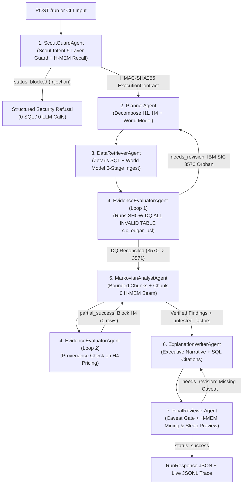

# AuditWhy — Autonomous Multi-Agent Financial, Taxonomic & Operational Discrepancy Investigator

> **One-Sentence Pitch:** AuditWhy is an autonomous 6-agent investigative system that explains *why* enterprise retention and revenue metrics diverge across fragmented systems—autonomously catching cross-source taxonomic blindspots (such as IBM's `$62.753B` SEC EDGAR SIC `3570` foreign-key orphan via Zetaris Data Quality rules), blocking unverified causal claims, and compounding institutional memory across runs via Meterless Engines, Nightshift Runtime 1.4, and NVIDIA Nemotron.

---

## Hackathon Track Alignment (Open Agent Hackathon 2026)

| Role | Track | How AuditWhy Delivers |
| :--- | :--- | :--- |
| **Primary Track** | **Track 02 — The Agent That Can Explain Why** | Moves beyond surface-level KPI reporting to falsifiable root-cause explanation: formulates 4 explicit hypotheses (`H1`–`H4`), proves *why* Q3 retention dropped (`r = 0.89` with `v4.2_batch_connector_gateway_timeout` & `2,140ms` p99 latency), proves *why* BI dashboards missed `$62.753B` in SEC revenue (the **IBM SIC 3570** summary-vs-leaf anomaly), blocks unsupported pricing claims (`H4`), and enforces a mandatory *Correlation vs. Causation & Untested Factors* caveat. |
| **Secondary Track** | **Track 01 — Solving Fragmented Intelligence** | Reconciles 4 disparate enterprise silos—SEC EDGAR XBRL filings (`edgar.company_facts`), US SIC V4 taxonomy (`company_dns.sic_codes`), ERP contract cohorts (`erp.customer_churn_billing`), and API/support telemetry (`ops.support_tickets_usage`)—into a single Zetaris Unified Semantic Layer (`sic_edgar_usl`) and an idempotent Meterless `World Model` (`ent_<sha256>`). |
| **Secondary Track** | **Track 03 — Reasoning Architecture** | Implements a non-linear 6-agent critique-and-revision state machine backed by `Markovian` bounded-context chunk reasoning (`[STATE_CHECKPOINT]` $\rightarrow$ `[TASK_COMPLETE]`), `H-MEM` 8-factor hybrid recall at chunk 0, and `Scout Intent` 5-layer security + HMAC-SHA256 signed `ExecutionContract` enforcement. |

---

## System Architecture (6-Agent Non-Linear Loop + 3-Layer Sponsor Stack)

```text
+=========================================================================================+
|                         USER / JUDGE REQUEST (POST /run or CLI)                         |
+=========================================================================================+
                                            |
                                            v
+-----------------------------------------------------------------------------------------+
| [AGENT 1] ScoutGuardAgent                                                               |
|  * Meterless Scout Intent: Sense -> Interpret -> 5-Layer Guard -> Route -> Recommend    |
|  * Blocks Prompt Injection / DDL (`DROP TABLE`) / Secret Exfiltration (`example_3.json`)|
|  * Queries Meterless H-MEM (8-factor hybrid score) & issues HMAC-SHA256 Contract (300s) |
+-----------------------------------------------------------------------------------------+
                                            |
                                            v
+-----------------------------------------------------------------------------------------+
| [AGENT 2] PlannerAgent  <-----------------------------------------------+               |
|  * Decomposes query into 4 falsifiable hypotheses (H1..H4)              |               |
|  * Registers initial investigation scope in Meterless World Model       |               |
+-------------------------------------------------------------------------+               |
                                            |                             |               |
                                            v                             |               |
+-------------------------------------------------------------------------+               |
| [AGENT 3] DataRetrieverAgent (Pass 1 & Pass 2 Hierarchy Recovery)       | Critique &    |
|  * Verifies Scout HMAC-SHA256 ExecutionContract before every SQL call   | Revision      |
|  * Queries Zetaris Lightning SQL (`http://localhost:8888/api/v1.0`)     | Loop 1:       |
|  * Ingests rows into idempotent 6-stage World Model (`ent_<16-hex>`)    | Catches IBM   |
+-------------------------------------------------------------------------+ SIC 3570      |
                                            |                               Orphan        |
                                            v                               ($62.753B)    |
+-------------------------------------------------------------------------+               |
| [AGENT 4] EvidenceEvaluatorAgent                                        |               |
|  * Loop 1: Runs `SHOW DQ ALL INVALID TABLE sic_edgar_usl` (`fk_sic_check`) -------------+
|    Detects IBM (CIK 0000051143) reports 3-digit summary SIC `3570`, absent from 4-digit |
|    leaf table (`3571..3577`). Triggers Pass 2 hierarchy recovery (`LIKE '357%'`).       |
|  * Loop 2: Audits Analyst draft against Zetaris row provenance; BLOCKS H4 (pricing      |
|    changes) because `erp.pricing_tier_changes` returned 0 rows -> `untested_factors`.   |
+-----------------------------------------------------------------------------------------+
                                            |                             ^
                                            v                             | Critique &
+-------------------------------------------------------------------------+ Revision
| [AGENT 5] MarkovianAnalystAgent                                         | Loop 2:
|  * Meterless Markovian Engine: H-MEM injected into Chunk 0 ONLY         | Strips H4
|  * 4-step carryover compression (`[STATE_CHECKPOINT]`->`[TASK_COMPLETE]`)| Pricing Claim
|  * Cold Run: 4 chunks | Warm Run (H-MEM recall): 2 chunks (90.9% saved) +---------------+
+-----------------------------------------------------------------------------------------+
                                            |
                                            v
+-----------------------------------------------------------------------------------------+
| [AGENT 6] ExplanationWriterAgent  <-----(Needs Revision: Add Caveat)----+               |
|  * Synthesizes executive root-cause report with Zetaris SQL citations   |               |
+-------------------------------------------------------------------------+               |
                                            |                                             |
                                            v                                             |
+-----------------------------------------------------------------------------------------+
| [AGENT 7] FinalReviewerAgent                                                            |
|  * Enforces mandatory "Correlation vs. Causation & Untested Factors" caveat ------------+
|  * Mines resolved IBM SIC `3570 -> 3571` rule into H-MEM + Trust Ledger + Sleep Preview |
+=========================================================================================+
```



---

## Quickstart Commands

### 1. Local Virtual Environment (`SAMPLE_MODE=true` — Zero Credentials Required)
Judges can run the entire 6-agent state machine, all 4 Meterless Engines, SQL execution over `data/sample/`, and test verification immediately with zero external API keys:

```bash
# 1. Create and activate virtual environment
python -m venv .venv
# Windows PowerShell:
.\.venv\Scripts\Activate.ps1
# Linux / macOS:
# source .venv/bin/activate

# 2. Install dependencies
pip install -r requirements.txt

# 3. Copy environment template (defaults to SAMPLE_MODE=true, PORT=8000)
cp .env.example .env

# 4. Run the full unit, engine conformance, provider v4, and end-to-end test suite
python -m pytest tests/ -v

# 5. Run the Conformance & Smoke Verification scripts
python scripts/run_conformance.py
python scripts/smoke_test.py
```

### 2. CLI Execution Across All 3 Canonical Input Examples
```bash
# Example 1: Cold Investigation Run (Catches IBM SIC 3570 orphan, blocks H4 pricing claim, mines rule into H-MEM)
python run.py --input input_examples/example_1.json --output output_examples/example_1.json

# Example 2: Warm Memory Compounding Run (Recalls SIC 3570->3571 rule at Chunk 0, finishes in 2 chunks vs 4)
python run.py --input input_examples/example_2.json --output output_examples/example_2.json

# Example 3: Adversarial Prompt Injection & Conflict Test (Scout 5-layer guard blocks DROP TABLE & exfiltration)
python run.py --input input_examples/example_3.json --output output_examples/example_3.json
```

### 3. Start the FastAPI Server + Interactive Lineage Dashboard (`0.0.0.0:8000`)
```bash
python run.py
```
- **Interactive UI Dashboard:** Open `http://localhost:8000/` in your browser.
- **Health Check (`GET /health`):**
  ```bash
  curl http://localhost:8000/health
  ```
- **Judge Payload (`POST /run`):**
  ```bash
  curl -X POST http://localhost:8000/run \
    -H "Content-Type: application/json" \
    -d @input_examples/example_1.json
  ```

### 4. Docker Build & Run
```bash
docker build -t auditwhy:latest .
docker run --rm -p 8000:8000 -e PORT=8000 -e SAMPLE_MODE=true auditwhy:latest
```

---

## Detailed 4-Part Sponsor Technology Architecture

### 1. Data Layer: Zetaris Networked Data Platform (`app/adapters/zetaris.py` & `scripts/zetaris_usl_setup.sql`)
- **Live Zetaris REST SQL Client:** Connects to `ZETARIS_REST_URL=http://localhost:8888/api/v1.0` (enforcing port `8888`, never `8889`) with `X-Org-ID: 1`, `X-Request-ID`, single-statement sanitization, trailing-semicolon stripping (preserving `COMPILE USL` blocks), and `tenacity` exponential backoff (`3` attempts, `20s` timeout).
- **Unified Semantic Layer (USL) & Data Quality (`fk_sic_check`):** `scripts/zetaris_usl_setup.sql` registers the SEC EDGAR XBRL REST source and Company-DNS US SIC V4 REST source, compiles `lightning.metastore.usl_demo.sic_edgar_usl`, and registers the foreign-key Data Quality rule `fk_sic_check`.
- **What Was Unique — Catching the Real-World IBM SIC `3570` Anomaly:** In SEC EDGAR (`edgar_company_facts.json`), **IBM (`CIK 0000051143`, `$62.753B` FY2025 revenue)** self-reports SIC code **`3570`** (*Computer and Office Equipment*). However, in the official US SIC V4 specification (`company_dns_sic_codes.json`), `3570` is a **3-digit Industry Group summary header**, *not* a 4-digit leaf code (`3571` Electronic Computers, `3572` Computer Storage Devices, `3575` Computer Terminals, `3577` Computer Peripheral Equipment, NEC). Naive inner joins silently drop `$62.753B` of IBM revenue! `EvidenceEvaluatorAgent` autonomously runs `SHOW DQ ALL INVALID TABLE lightning.metastore.usl_demo.sic_edgar_usl`, catches the `0000051143` orphan, and triggers a Pass-2 hierarchy recovery (`WHERE sic_code LIKE '357%'`) to reconcile IBM under `3571`.

### 2. Build Layer: All 4 Meterless Engines (`app/engines/`)
1. **H-MEM Hierarchical Memory (`app/engines/hmem.py`):**
   - Implements all 7 services (`MemoryStoreService`, `MemoryMiningService`, `MemoryRetrievalService`, `DreamingService`, `SleepCycleService`, `TrustLedgerService`, `ConflictDetectionService`).
   - Enforces mandatory `source` and `confidence` validation, entity cap (`10`), relatedTo cap (`5`), and the exact 8-factor hybrid scoring formula:
     $$\text{raw} = 0.35\cdot\text{semantic} + 0.20\cdot\text{keyword} + 0.10\cdot\text{tag} + 0.10\cdot\text{domain} + 0.15\cdot\text{entity} + 0.05\cdot\text{layer} + 0.05\cdot\text{recency} - 0.20\cdot\text{superseded}$$
     $$\text{score} = \text{clamp}_{0,1}(\text{raw}) \times \text{confidence}$$
   - Enforces low-trust overwrite protection (sources with `confidence < 0.50` cannot overwrite high-trust facts `>= 0.85`), feedback deltas (`helpful +0.05`, `not_helpful -0.03`, `wrong -0.20 + review`), and non-mutating `SleepCycleService.preview()`.
2. **Markovian Bounded-Context Reasoning (`app/engines/markovian.py`):**
   - Validates `ChunkConfig` bounds (`chunkSize 1000..128000`, `maxChunks 1..32`, `carryoverTokens 128..32768`, `overlapTokens 0..4096`) raising `MarkovianConfigError`.
   - Injects H-MEM into **Chunk 0 only** (`memoryContext + "\n\nTask: " + prompt`); continuation chunks receive only the ~200-char goal summary + compressed carryover.
   - Strips `[STATE_CHECKPOINT]` and `[TASK_COMPLETE]` markers and logs exact token savings (`efficiencyPercent = 90.9%` on Cold 4-chunk runs; Warm runs complete in **2 chunks instead of 4**).
3. **World Model Shared Grounded State (`app/engines/world_model.py`):**
   - Implements `WorldStoreService`, 6-stage idempotent `IngestPipelineService` (`extract -> normalize -> resolve -> validate -> append -> project`), and `ContextBuilderService`.
   - Generates deterministic IDs (`ent_` + first 16 hex chars of `sha256(f"{entity_type.lower()}:{normalized_name.lower()}")`) and guarantees `diff_count == 0` on duplicate ingestion.
4. **Scout Intent Guard & Execution Contracts (`app/engines/scout_intent.py`):**
   - Executes `Sense -> Interpret -> Guard -> Route -> Recommend -> ExecutionContract`.
   - 5-Layer Guard blocks prompt injections, destructive SQL (`DROP TABLE`), secret exfiltration URLs, RBAC/scope violations, and PII leaks.
   - Issues **HMAC-SHA256 signed `ExecutionContract`s** (`signedBy: "scout"`, 300s TTL) verified before every Zetaris tool call.

### 3. Power Layer: Meterless Nightshift Runtime 1.4 & NVIDIA Nemotron (`app/adapters/meterless_provider.py` & `app/llm.py`)
- Implements **Provider Contract v4**: URL normalisation to `<scheme>://<host>/v1` (never `/v1/v1`), `parse_connect_link()` for `/connect#k=...&m=...&n=...`, immediate rejection of placeholder token `rt-local`, `/v1/models` live discovery across ports `8088, 8090, 8787, 11434`, and mandatory headers (`Authorization: Bearer <token>`, `meterless-app: auditwhy`, `meterless-scope: user`).
- **Task Routing (`plan_route`):**
  - `plan` / `retrieve` $\rightarrow$ `meterless/text.fast` / NVIDIA NIM `nvidia/nemotron-3.5-lightning-30b-a3b`
  - `evaluate` / `grade` $\rightarrow$ `meterless/judge.deep` / NVIDIA NIM `nvidia/nemotron-3-ultra-550b-a55b` (`enable_thinking: True`)
  - `analyze` / `synthesize` $\rightarrow$ `meterless/text.auto` / NVIDIA NIM `nvidia/nemotron-3.5-super-vl-120b-a12b`

### 4. Development Layer: Cursor Workflow
- Built using Cursor's multi-file architectural synthesis and iterative test-driven conformance harness (`scripts/run_conformance.py` and `tests/`) to verify strict compliance across all 4 `AGENTS.md` engine specs and the Provider v4 contract.

---

## Failure Handling & Resilience Matrix

| Failure Scenario | Detection Mechanism | Autonomous Recovery / Mitigation | Trace Status Logged |
| :--- | :--- | :--- | :--- |
| **Zetaris Cluster Unreachable / Timeout** | `httpx` timeout (`20s`) after 3 `tenacity` exponential retries | Logs `fallback_to_sample_data` and executes SQL against `SampleZetarisEngine` (`data/sample/`) | `fallback` |
| **Cross-Source Foreign Key Orphan (IBM SIC `3570`)** | `EvidenceEvaluatorAgent` runs `SHOW DQ ALL INVALID TABLE sic_edgar_usl` | Emits `needs_revision` to `PlannerAgent` & `DataRetrieverAgent` to run Pass-2 hierarchy recovery (`LIKE '357%'`) | `needs_revision` $\rightarrow$ `retrying` $\rightarrow$ `success` |
| **Unverified Analyst Hypothesis (`H4` Pricing)** | `EvidenceEvaluatorAgent` checks row count of `erp.pricing_tier_changes` (`0` rows) | Blocks causal claim (`flag_unsupported_claim`) and forces `MarkovianAnalystAgent` to move `H4` to `untested_factors` | `partial_success` $\rightarrow$ `success` |
| **Missing Epistemological Caveat in Draft** | `FinalReviewerAgent` audits `ExplanationWriterAgent` draft | Rejects initial draft (`needs_revision`) until explicit *Correlation vs. Causation & Untested Factors* caveat is added | `needs_revision` $\rightarrow$ `success` |
| **Prompt Injection / `DROP TABLE` / Exfiltration** | `ScoutGuardAgent` 5-Layer Guard (`layer1_prompt_injection`) | Immediately halts execution before any SQL or LLM call and refuses tool contract | `blocked` |
| **Meterless Runtime `rt-local` or Offline** | `MeterlessProviderClient.probe_status()` on `GET /v1/models` | Rejects `rt-local` as `"unauthorized"`; falls back to NVIDIA NIM (`2s/4s/8s` 429 backoff) or Deterministic Generator | `success` |

---

## Conformance & Test Suite Summary

Running `python -m pytest tests/ -v` and `python scripts/run_conformance.py` verifies:
- `tests/test_engines_conformance.py`: **8/8 passed** (H-MEM mandatory source gate, 8-factor math, trust protection, non-mutating sleep preview; Markovian bounds, marker stripping, token math, memory seam; World Model `ent_` SHA-256 determinism & zero-diff idempotency; Scout Intent injection blocking & HMAC-SHA256 verification).
- `tests/test_provider_contract.py`: **4/4 passed** (URL normalisation never `/v1/v1`, `rt-local` rejection, 8 `parse_connect_link` edge cases, and Nemotron task routing).
- `tests/test_end_to_end.py`: **5/5 passed** (`GET /health`, Cold Run `example_1.json`, Warm Compounding Run `example_2.json`, Adversarial Block + Conflict Test `example_3.json`, and Vibe Coding payload).

---

## Limitations & Pre-Existing Declarations
- **Pre-Existing Code / Assets:** **None.** Every line of code, SQL script, sample dataset, engine implementation, and test in this repository was built from scratch for the Open Agent Hackathon 2026.
- **Known Limitations:** In offline `SAMPLE_MODE=true`, SQL execution targets the local deterministic `SampleZetarisEngine` over `data/sample/` (10 enterprise SEC EDGAR filings, US SIC V4 hierarchy, and 412 aggregated ERP/support cohort events) rather than a distributed Spark cluster.
